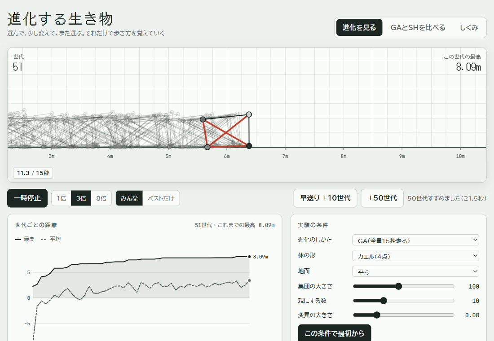

# 進化する生き物

関節（点）と筋肉（バネ）でできた2Dの生き物が、進化計算で歩き方を覚えていくのを眺めるブラウザアプリです。

**試す：https://nusag1.github.io/evo-creatures/** （開くと第1世代から自動で進化がはじまります）

## できること
- **進化を見る**：1世代＝15秒の走り。集団全員か、いちばん遠くまで進んだ1匹だけを表示。1倍・3倍・8倍速、+10／+50 世代の早送り
- 条件を変えて試す：体の形（カエル・サンカク・イモムシ・ムカデ）、地面（平ら・でこぼこ・のぼり坂・階段）、集団の大きさ・親にする数・変異の大きさ
- 世代ごとの最高・平均距離のグラフ
- **GA と SH を比べる**：同じ計算量で、GA（遺伝的アルゴリズム）と Successive Halving（SH）を並べて進化させる
- お気に入り：いまのベストを保存してあとで再生（見る人のブラウザの中だけに保存）

## 使った技術
- HTML / CSS / JavaScript（1ファイルの `index.html`、ライブラリなし）、Canvas 2D、localStorage、Service Worker（PWA）、GitHub Pages
- **物理**：ベルレ積分（1/120 秒刻み）＋筋肉の長さの拘束（4回くり返し）。地面は動かない壁で、足ごとの「つかむ強さ」で横すべりを止める。速さの上限 6m/s
- **遺伝子**：リズムの周期（0.8〜2.0 秒）、足ごとのつかむ強さ（0〜1）、筋肉ごとの伸び縮みの大きさ（0〜25%）・タイミング・基本の長さ（0.85〜1.15 倍）
- **評価**：15 秒で右へ進んだ距離（点の平均の x）
- **GA**：上位 K 匹をエリートとして残し、残りは親をコピーして全遺伝子にガウスの変異（交叉なし）
- **SH**：子を 1.875 → 3.75 → 7.5 → 15 秒の予選で半分ずつ落とす（落とさなかった子は続きから走らせる）

## 工夫したところ・むずかしかったところ
- **公平な比べ方**：計算量を「1匹を1秒動かす＝1」と数え、少ないほうを1世代ずつ進めることで、GA と SH を同じ計算量で並べられるようにした。エリートの点数は使い回し、計算するのは子だけ
- **取りこぼしを数える**：SH が予選で落とした子も裏で最後まで走らせ、「本当は上位 K 匹に入れたのに落とした数」を表示する（この分は計算量に入れない）。速さと引きかえに何を失っているかが見える
- **ズルの対策**：地面にめりこんで跳ね返る動きで距離をかせぐ「ズル」を止めた（地面は動かない壁として扱い、速さには上限を設けている）
- **重くしない**：GA と SH を比べるモードでは、1回にまとめて進める計算を約 40 ミリ秒までに区切り、計算中も画面が固まらないようにした

## 作り方
企画・仕様・設計の判断は自分で行い、コードは AI（Claude）と一緒に書きました。
